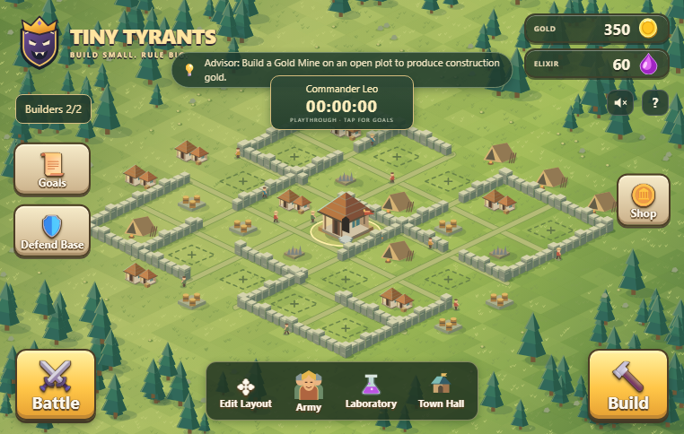

# Tiny Tyrants · v1.2

<p align="center">
  
</p>

<p align="center">
  <strong>Build a tiny village. Train a mighty army. Rule the kingdom.</strong>
</p>

<p align="center">
  <a href="https://tiny-tyrants.netlify.app/">🎮 Play Live</a> •
  <a href="#features">Features</a> •
  <a href="#gameplay--strategic-guide">Guide</a> •
  <a href="#architecture">Architecture</a> •
  <a href="#local-development">Development</a> •
  <a href="#testing--quality-gates">Testing</a> •
  <a href="#save-data-engineering">Save Data</a>
</p>

---



## Overview

**Tiny Tyrants** is a single-player village strategy and tactical raiding game built with vanilla HTML, CSS, JavaScript, and HTML5 Canvas.

Starting with an humble Town Hall on an isolated island, you manage resources, plan defensive fortifications, train diverse troop classes, raid enemy island strongholds across multiple distinct biomes, and repel siege waves threatening your hall. A persistent speedrun timer records your playthrough from first registration to full base completion.

---

## What’s New in v1.2

- **Storage & Reliability Engine (`storage.js`)**:
  - Versioned schema (v2) with validation and automatic migration for v1.0 and v1.1 browser saves.
  - Automatic rolling backup under `tiny-tyrants-v1:backup` with crash recovery.
  - Manual JSON save export and import with pre-import validation and rollback safety.
  - Safe in-memory fallback when browser storage is disabled or quota is exceeded.
- **Enhanced Combat Tactics (`raid.js`)**:
  - **Tactical Roles**: Wall Breakers focus on destroying gates with a 4x siege bonus and halt troops until gates crumble; Giants absorb tower fire with 20% passive armor; Healers target low-health allies.
  - **Battle Controls**: Pause & Resume (`Space`) and 1x / 2x Speed toggle (`S`).
  - **Visual Feedback**: Floating combat indicators, color-coded health meters, and detailed post-battle reports broken down by troop class.
- **Progression & Economy (`game.js`)**:
  - **Smart In-Game Advisor**: Real-time contextual guidance banner directing players on their next optimal strategic milestone.
  - **Extended Offline Production**: Resource generation continues for up to 10 hours offline with clock-skew protection.
  - **Settlement Defense Polish**: Added pause, speed controls, and balanced wave scaling.
- **Accessibility & UX**:
  - Modal dialog focus management and keyboard Tab navigation trap.
  - `prefers-reduced-motion` support to tone down animations and canvas particles.
- **Automated Quality Gates**:
  - Multi-platform GitHub Actions CI running unit and regression suites on Node.js 20, 22, and 24.
  - Dependency-free unit test suites covering save reliability, economy balance, and combat invariants.
  - Browser end-to-end tests driving headless Chrome via Chrome DevTools Protocol.

---

## Features

- 🏰 **5 Ages of Progression**: Advance your Town Hall from a Timber Village to a Fortified Citadel.
- 🌾 **Two-Resource Economy**: Mine Gold to erect and reinforce structures; gather Elixir to muster your fighting forces.
- 🪖 **5 Specialized Troop Classes**:
  - **Warrior** (`vanguard`): Swift, versatile frontline infantry.
  - **Archer** (`ranger`): Long-range support unit able to fire over walls.
  - **Giant** (`bulwark`): Armored behemoth drawing defensive aggro.
  - **Wall Breaker** (`sapper`): Explosive specialist that shatters gates.
  - **Healer** (`weaver`): Divine spellcaster restoring wounded soldiers.
- 🗺️ **15 Hand-Crafted Sky Expeditions**: Battle through cloud forests, badlands, glacial fjords, amethyst moors, and golden highlands.
- 🛡️ **Interactive Settlement Defense**: Test your layout against aggressive incoming enemy waves with manual targeting and explosive flares.
- ⏱️ **Persistent Speedrun Timer**: Measures elapsed time from player registration to full base completion—persisting even when the browser is closed.
- 💾 **Zero External Dependencies**: Pure client-side web application with zero telemetry, trackers, or build steps.

---

## Gameplay & Strategic Guide

### 1. The Foundation Sequence
New settlements must prioritize establishing three foundational pillars before expanding or advancing Town Hall age:
1. **Gold Mine** (`mine`): Supplies the gold necessary for structural construction.
2. **Elixir Collector** (`farm`): Gathers the elixir required to recruit soldiers.
3. **Army Camp** (`barracks`): Expands military housing capacity.

### 2. Campaign Expeditions
Click **Battle** to scout enemy outposts:
- Choose from 3 distinct landing paths (Mist Path for damage reduction, High Bridge for direct access, or East Ridge for movement speed).
- Deploy Wall Breakers to crack fortified gates before sending in frontline troops.
- Deploy Giants first into tower ranges to soak up defensive fire and protect fragile Archers and Healers.
- Trigger the **Freeze Spell** (`Q`) to silence all defending towers for 3 seconds during critical pushes.
- Field Hospitals automatically tend to and rescue fallen soldiers after every raid.

### 3. The Max-Base Completion Condition
To finish a speedrun and claim your victory screen:
- Reach **Town Hall level 5**.
- Build all **9 non-hall building types**.
- Upgrade all **11 remaining plots to level 6**.
- Ensure no construction jobs are actively pending.

---

## Architecture

Tiny Tyrants is architected into clean, modular vanilla JavaScript subsystems:

```
┌─────────────────────────────────────────────────────────────┐
│                         index.html                          │
└──────────────┬───────────────────────────────┬──────────────┘
               │                               │
       ┌───────▼───────┐               ┌───────▼───────┐
       │   style.css   │               │    art.js     │
       │ (Layout & UI) │               │(Isometric Rd) │
       └───────────────┘               └───────┬───────┘
                                               │
       ┌───────────────┐               ┌───────▼───────┐
       │  storage.js   │◄──────────────┤    game.js    │
       │ (Save & Schema│               │(Economy/Town) │
       └───────┬───────┘               └───────┬───────┘
               │                               │
       ┌───────▼───────┐               ┌───────▼───────┐
       │    raid.js    │◄──────────────┤progression.js │
       │(Combat Sim)   │               │(Timer/Ending) │
       └───────────────┘               └───────────────┘
```

- **`storage.js`**: Core reliability engine. Validates data schemas, manages automatic rolling backups, repairs partially malformed entries, and provides JSON file export/import.
- **`art.js`**: Isometric 2.5D rendering engine utilizing Canvas 2D. Renders village buildings, moving workers, roads, scenery, and respects `prefers-reduced-motion`.
- **`raid.js`**: Expedition combat simulation, map generators, unit AI, pathfinding, projectile kinematics, particle systems, and battle results.
- **`game.js`**: Economy tick engine, construction queues, laboratory troop research, layout editor, audio synthesizer, and settlement siege defenses.
- **`progression.js`**: Player name registration, persistent elapsed timer, speedrun goal evaluation, and victory screen.

---

## Save-Data Engineering

State is saved in the browser under the `tiny-tyrants-v1` key.

### Reliability Guarantees
- **Validated Loading**: Every property (gold, grain, stage, building levels, jobs, army counts, research ranks) is sanitized and clamped to valid bounds.
- **Backward Compatibility**: Automatically migrates v1.0 and v1.1 saves to schema version 2 without loss of progress.
- **Automatic Rolling Backup**: Before replacing save data, the prior valid state is preserved under `tiny-tyrants-v1:backup`.
- **Corruption Recovery**: If the primary storage string becomes corrupted, the engine automatically attempts to recover from the backup.
- **Emergency Archiving**: Unparseable primary strings are saved under `tiny-tyrants-v1:corrupted-<timestamp>` to ensure raw data can be retrieved.
- **Manual Backups**: Players can download their village as a portable `.json` file at any time from the handbook or start screen, and restore it across any device.

---

## Local Development

No build tools, bundlers, or package installations are required.

```bash
# Clone the repository
git clone https://github.com/Mannan55/tiny-tyrants.git
cd tiny-tyrants

# Start a static file server
python -m http.server 8080
# or: npx serve .
```

Open `http://localhost:8080` in any modern web browser.

---

## Testing & Quality Gates

Tiny Tyrants features comprehensive, dependency-free automated tests using Node.js built-in test runner:

```bash
# 1. Syntax Verification
node --check art.js
node --check storage.js
node --check raid.js
node --check game.js
node --check progression.js

# 2. Save Reliability & Schema Migration
node --test tests/save-reliability.test.cjs

# 3. Economy & Construction Balance
node --test tests/economy-progression.test.cjs

# 4. Combat Simulation Invariants
node --test tests/combat-simulation.test.cjs

# 5. Legacy v1.1 Progression Regression Suite
node tests/progression.test.cjs

# 6. Real Headless Browser End-to-End Test (Optional)
node --test tests/e2e-browser.test.cjs
```

---

## Known Limitations

1. **Local Browser Storage**: Because save files reside in `localStorage`, clearing site data or using private/incognito browsing will wipe local state unless the user exports a JSON backup.
2. **Single Village per Origin**: The current version supports one active village per browser origin at a time (additional villages can be archived and swapped via JSON export/import).
3. **Sound**: Web Audio synthesizer requires initial user interaction with the page to unlock audio context in accordance with browser autoplay policies.

---

## Planned for v1.3

- **Multiple Save Profiles**: Support saving and switching between up to 3 named local village profiles.
- **Expanded Campaign Acts**: Introducing Act II strongholds with naval approaches and barricade towers.
- **Building Relocation Undo**: One-click layout undo/redo during base layout editing.
- **Soundtrack & Audio Themes**: Additional ambient village soundscapes and combat cues.

---

## Contributing

Contributions, bug reports, and suggestions are welcome! Please read [CONTRIBUTING.md](CONTRIBUTING.md) and [SECURITY.md](SECURITY.md) before submitting pull requests.

## License

Proposed under the [MIT License](https://opensource.org/licenses/MIT). *(Subject to confirmation by repository owner).*
